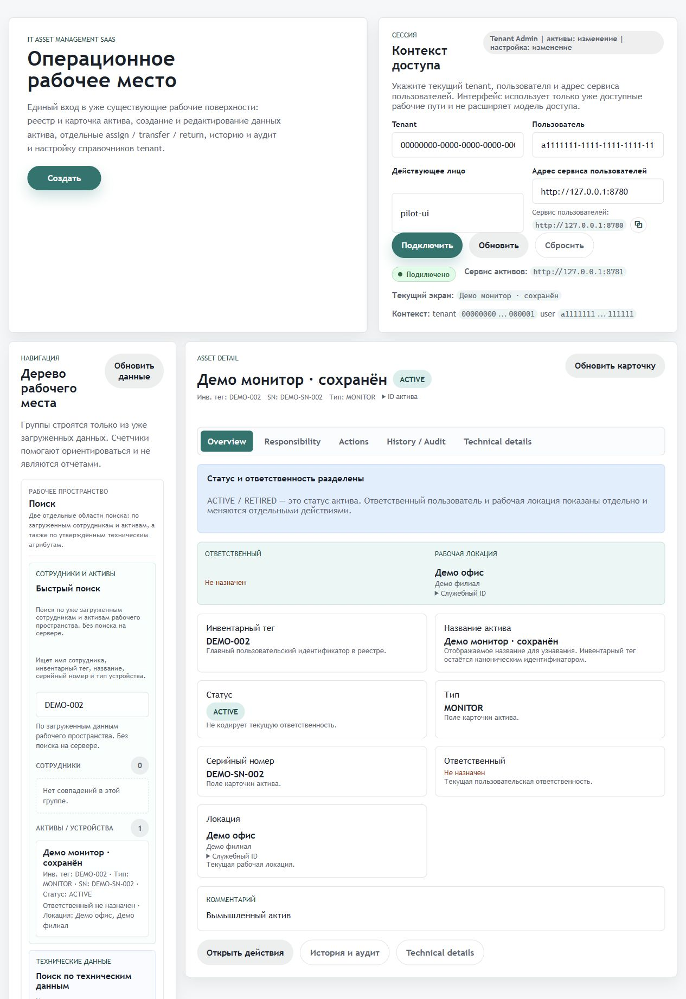

# Учёт IT оборудования

Монорепозиторий ограниченного ITAM pilot: пользователи и оргструктура, реестр активов, назначение/передача/возврат, история и аудит, склад, обслуживание, ПО, тикеты и операционные сводки.

## Реализованные возможности
Asset/user API дополнены обращениями сотрудников, типами оборудования, SIM-картами, картриджами и QR. Lifecycle guards запрещают назначать списанные активы; обновления ответственности блокируют строки. Handoff в склад имеет три попытки, но не является durable outbox.

Стек: Java 17, Spring Boot 3.2.5, Gradle 8.7, JDBC, Flyway, PostgreSQL; H2 для изолированных тестов и demo. Семь сервисов находятся в services/, API и ADR — в Documentation/.

## Посмотреть и запустить
[Локальная демонстрация](docs/demo.md) запускает настоящие asset/user API без рабочих интеграций. [Миграционный план](docs/migrations.md) разделяет чистую установку и сохранение legacy checksum. Проверки: `./gradlew test`; CI выполняет отдельные service suites.

Расширенный private UI сохранён отдельно в `/workspace/index.html` как opt-in preview. Основной `/` сохраняет проверенный публичный pilot UI; новые backend API доступны независимо. Preview не заменяет проверку жизненного цикла.

## Границы
Это pilot, а не готовый публичный SaaS. X-Authenticated headers требуют доверенного gateway; выбор роли в UI не заменяет аутентификацию. Reporting не является BI, склад не является полной WMS. Demo fixtures вымышлены. Сетевая QR-генерация и остальные сервисы требуют отдельной проверки. PostgreSQL upgrade legacy-линии должен быть проверен на копии БД до выпуска.

Лицензия проекта владельцем пока не выбрана. Сторонние уведомления и лицензии сохранены.

## Проверка и реальный экран

[Результаты и ограничения проверки](docs/verification.md). Скриншот получен при локальном запуске на вымышленных данных.

